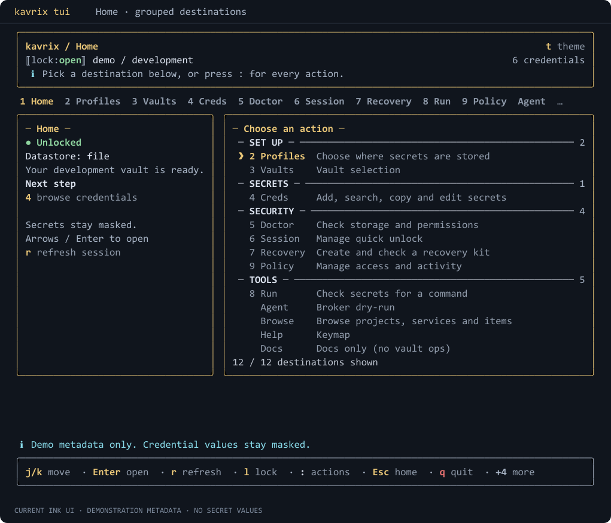
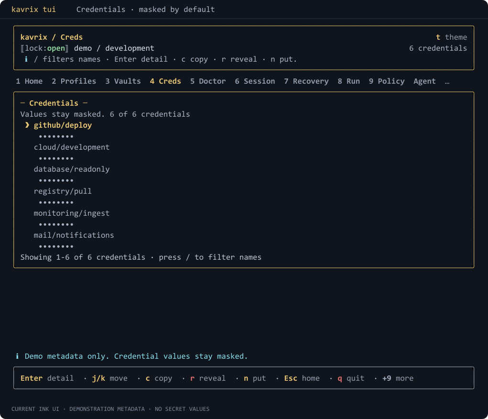
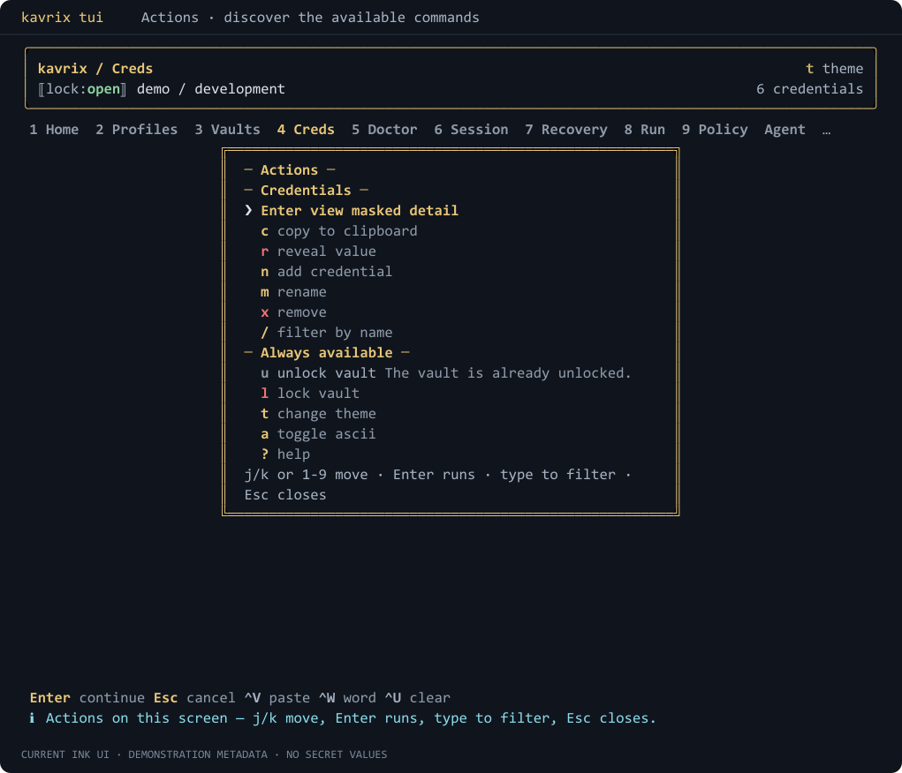

# Kavrix

**Secrets stay in Kavrix. Applications get access. Agents get permission.**

A local-first secrets firewall for developers, applications, and AI agents.

Zero-knowledge local encryption: Kavrix never sees your passphrases or plaintext
credentials.

Give applications and AI agents access to credentials without handing them your
`.env`. Kavrix decides which process may receive a secret, under which policy or
grant, and records what happened — without shipping secrets to a Kavrix cloud.



## Why not paste a `.env`?

- **Scoped secret execution** — inject only the credentials a command needs, for
  that process only (`kavrix run`).
- **Policies and grants** — bound executables, SHA-256 pins, TTLs, confirmation,
  max-use, and revocable temporary access.
- **AI agent isolation** — agents hold no credential material; they ask a local
  broker per operation (`kavrix agent run`).
- **Auditability** — review authorization and use events without secret
  plaintext (`kavrix audit`).
- **Local-first** — encrypted storage on your machine (local file or your own
  MongoDB). No Kavrix server, account, or telemetry.

The encrypted vault is infrastructure. The product is the secrets firewall in
front of it.

## Quick start

```sh
npm install --global kavrix

kavrix init                     # one-time setup (interactive; --json for scripts)
kavrix add github/token         # store a secret, encrypted
kavrix ls                       # list names — values stay masked
kavrix get github/token --reveal
kavrix run --secret TOKEN=github/token -- printenv TOKEN
```

Secret values are never accepted as arguments: they come from a masked prompt,
stdin frames, a protected key file, or the OS keychain. Scripted flows use
`--passphrase-stdin` / `--value-stdin` with the exact frame order from
`kavrix frames <command>`.

## Everyday commands

| Command                  | Purpose                                                                         |
| ------------------------ | ------------------------------------------------------------------------------- |
| `kavrix init`            | Set up your first encrypted vault.                                              |
| `kavrix add <name>`      | Encrypt and store one secret.                                                   |
| `kavrix get <name>`      | Show one credential, masked by default (`--reveal` prints it).                  |
| `kavrix ls [pattern]`    | List credential names, or filter with a glob/substring.                         |
| `kavrix rm <name>`       | Delete one credential.                                                          |
| `kavrix mv <from> <to>`  | Rename a credential, keeping its encrypted value.                               |
| `kavrix generate [name]` | Generate a random secret locally; store it without display.                     |
| `kavrix run`             | Execute a command with selected credentials injected into its environment only. |
| `kavrix tui`             | The full interactive app.                                                       |

Advanced operations (multi-vault databases, profiles, owner keys, recovery
kits, legacy migration) live under `kavrix db ...`. Run `kavrix --help` or see
the [command guide](docs/cli-reference.md).

## Run tools without pasting secrets

```sh
# Inject selected credentials as environment variables only.
kavrix run --secret AWS_KEY=aws/deploy-key -- terraform plan
```

`kavrix run` takes the child after `--`, decrypts only the credentials you
name, and injects them into that one process — never through command
arguments, temp files, or your shell history.

## AI agents

```sh
# The agent holds no credentials; the local broker authorizes each request.
kavrix agent run --agent bot --config kavrix.yaml \
  --profile work --vault <vault-id> \
  -- codex
```

Inside an agent session, children inherit broker access and request credentials
through `kavrix agent exec`. Denials are distinguishable from broken
connections, and `kavrix audit` records the events.

The firewall is verified end to end: the agent process's environment and
arguments contain no credential material — only the local broker endpoint and
a one-session token. Every request is policy-evaluated against the agent's
permission entries (allowed commands, SHA-256 pins, TTL windows,
confirmations), the secret is injected into the authorized child only, denials
never start a child, and both outcomes are recorded in the sealed audit trail.
A missing or unresolvable broker-side executable reports `EXECUTION_FAILED`
(exit 18) exactly like `kavrix run` — never a fake authorization denial.

## Policies

```sh
# Bound what a credential may do before anything spawns.
kavrix policy create deploy --secret aws/deploy-key \
  --command terraform --hash terraform=<sha256> --ttl 30m --require-confirmation

# Simulate and explain without reading the credential.
kavrix policy check deploy -- terraform plan
kavrix policy explain deploy -- terraform plan
kavrix policy lint
kavrix policy diff deploy --secret aws/deploy-key --command terraform --ttl 15m
kavrix policy suggest
```

Policies support command allowlists, SHA-256 executable pins, execution-window
TTLs, working-directory restrictions, deny rules, reveal gating, and
confirmation requirements. Every decision is evaluated fail-closed before a
child process spawns.

## Temporary grants

```sh
# Hand out access that expires and can be revoked.
kavrix grant create aws/deploy-key --ttl 15m --max-uses 3
kavrix grant list
kavrix grant show <grant-id>
kavrix grant revoke <grant-id>
```

## Audit

```sh
# Review what happened, without secret material.
kavrix audit
```

## Interactive TUI

Current Ink UI captures with demonstration names and masked values.

```sh
kavrix        # interactive TTY: onboarding on first run, then the TUI
kavrix init   # explicit TUI onboarding (classic prompts with --no-tui)
kavrix tui    # full interactive app against the real CLI
```

**Credentials:** see names and masked values, filter with `/`, and open detail
with Enter. Copy and reveal remain explicit, confirmed actions.



**Actions:** press `:` or `Ctrl+K` to see available commands, shortcuts, and why
an action is blocked.



Use `kavrix init --no-tui` for classic line prompts, or stdin/explicit routing
for scripts. Bare `kavrix` on a non-interactive stream keeps printing help. The
TUI locks after two idle minutes or fifteen minutes since unlock.

## What's new

- **0.3.2 — documentation clarity.** Every user-facing guide now describes the
  current command surface directly. See the
  [0.3.2 release notes](docs/release-notes-0.3.2.md).
- **0.3.1 — simplified command surface.** The everyday commands are `add`,
  `get`, `ls`, `rm`, and `mv`; listing and filtering merged into
  `ls [pattern]`; advanced database, key, and migration operations live under
  `kavrix db`. See the [0.3.1 release notes](docs/release-notes-0.3.1.md).
- **0.3.1 — TUI reliability.** Every keypress, mouse, resize, and animation
  path now fails safe with a visible notice instead of crashing: router
  transitions, mouse handlers, shared animation clock, child-output JSON
  parsing, and session-expiry notifications are all guarded, a failed
  operation reports its actual error, and an unexpected crash restores your
  terminal.

## Local-first storage

Secrets stay encrypted on your machine: a protected local database file or your
own MongoDB deployment. One database holds multiple independently encrypted
vaults. Unlock material never leaves your control — there is no Kavrix-hosted
service in the path. Bring-your-own MongoDB is optional; the local file is
enough for most developer workflows.

## Structured credentials

Beyond flat `name → value` records, database vaults organize private data as
project context → service → credential item → typed fields, with encrypted
notes and history:

```sh
kavrix context create platform
kavrix service create github --context platform
kavrix item create deploy --context platform --service github
kavrix field set token --type api-key --context platform --service github --item deploy
```

Flat commands (`add`, `get`, `ls`) operate over the default context/service
projection, so `github/token` stays one literal name.

## Session unlock

Stop typing your passphrase on every command:

```sh
kavrix session enable     # seal unlock material behind the OS credential store
kavrix ls --session       # commands accept --session until it expires or is revoked
kavrix session revoke
```

Either half alone is useless, revocation removes both, and the passphrase
always still works.

## Import, export, backup

```sh
kavrix import env --file ./.env     # guarded .env import; offer to shred the source
kavrix export --file ./transfer.kavrix-export
kavrix import archive --file ./transfer.kavrix-export
kavrix backup create --file ./backup.kavrix-backup
kavrix backup verify --file ./backup.kavrix-backup
kavrix backup restore --file ./backup.kavrix-backup
```

## Requirements

- Node.js `>=24.12.0 <25` or `>=25.1.0`
- MongoDB only if you use that datastore (writes need a replica set)

## Installation

```sh
npm install --global kavrix
kavrix --version
```

If npm fails with an engines/`EBADENGINE` error, your Node.js version is outside
`>=24.12.0 <25` or `>=25.1.0` — upgrade or switch before retrying.

If npm fails with `EACCES` (prefix often `/usr/local`):

```sh
npm config set prefix ~/.local
export PATH="$HOME/.local/bin:$PATH"
npm install --global kavrix
```

Published npm may lag git `main`. For tip-of-main from a clone:

```sh
pnpm install --frozen-lockfile && pnpm build
pnpm exec kavrix --version
```

After a global npm install, keep current with:

```sh
kavrix update --check --json   # report only
kavrix update                  # npm install --global kavrix@<newest>
```

`kavrix update` only replaces detected global npm installs. Homebrew, pnpm,
yarn, npx, and workspace checkouts refuse with the exact manual upgrade
command. Non-TTY stdout is always JSON.

## Windows permissions

Kavrix enforces owner-only access on Windows through NTFS ACLs (the equivalent
of POSIX mode `700`/`600`). `kavrix init` and `kavrix db profile add` harden the
Kavrix home (`%USERPROFILE%\.kavrix`) automatically before writing keys, and
`kavrix doctor health --heal` repairs an existing Kavrix home. Directories
Kavrix does not own — your home directory itself, for example — are never
modified. Keep key, vault, and recovery files inside `~/.kavrix` (or another
directory only your account can access).

## Backups and recovery

Keep at least one database recovery kit on separate protected media from the
active owner key, and verify it with
`kavrix db recovery verify --profile work --recovery-file <path>` before you
rely on it. Back up datastore ciphertext and protected recovery material
separately.

For local-file sharing, generate a fresh share key with `kavrix db key create`
and transfer it together with the exact matching database file. That pair grants
full access to every vault once its passphrase is known; there is no
vault-scoped local sharing or revocation.

If every valid owner key file and every recovery kit is lost, the database is
permanently unrecoverable by design. There is no vendor reset or escrow,
because no one else ever held the required material.

## Security model

Kavrix controls which process receives a credential. Once an authorized process
receives it, Kavrix cannot control what that program does with the value.

Cryptography uses versioned authenticated encryption, not "unbreakable
encryption." Vault payloads, the private database catalog, and wrapped keys use
XChaCha20-Poly1305. Passphrase-protected files derive keys with Argon2id.
HKDF-SHA-256 separates key purposes, and associated data binds every ciphertext
to the exact database, vault, purpose, key version, revision, and metadata
digest.

A revision anchor authenticated by the database root key is stored beside each
active owner key file. Rollback attempts, same-revision forks, and inconsistent
catalog/vault heads are rejected before plaintext is returned, and a missing or
invalid anchor fails closed. Structured contexts, services, item metadata, field
definitions, notes, and attachment/history relationships stay inside the
client-encrypted vault payload.

MongoDB stores ciphertext plus opaque routing metadata in two collections. It
can observe the MongoDB database and collection namespaces, opaque IDs,
revisions, timestamps, ciphertext sizes, and access patterns. Human-readable
Kavrix database labels, vault labels, credential labels, and values remain
encrypted. Remote connections must explicitly enable validated TLS.

Details: [threat model](docs/threat-model.md),
[cryptography](docs/cryptography.md), [data model](docs/data-model.md).

## Limitations

- Kavrix cannot protect an unlocked host from administrators, same-user malware,
  keyloggers, terminal capture, clipboard capture, process-memory inspection, or
  swap and crash dumps. Secret buffers are cleared best effort; JavaScript
  cannot guarantee complete erasure.
- An authorized program can read its own environment. Execution controls add
  authorization and process hygiene; they do not constrain what a legitimate
  program does with values it was given.
- User identities, public enrollment, recipient discovery, per-vault grants and
  roles, revocation with rotation, and ownership transfer are not implemented.
- Windows command scripts (`.bat`, `.cmd`, `.com`) are refused for execution
  because launching them requires shell argument re-parsing; invoke real
  executables.

The [threat model](docs/threat-model.md) records the intended protections,
exclusions, and rollback handling in full.

## Documentation

Start with the [documentation index](docs/README.md):

- [Features](docs/features.md) — what Kavrix does, in plain language
- [Getting started](docs/getting-started.md) — task-based walkthroughs
- [Glossary](docs/glossary.md) — every term, defined
- [Command guide](docs/cli-reference.md)
- [Agent guide](docs/agent-guide.md)
- [Threat model](docs/threat-model.md)
- [Recovery guide](docs/backup-and-recovery.md)
- [Datastore policy](docs/local-database.md)
- [Architecture](docs/architecture.md)

## Support

Security issues follow [SECURITY.md](SECURITY.md); please do not open public
issues for them. Bug reports and feature requests go to the
[issue tracker](https://github.com/d4rkNinja/kavrix/issues). Contributions are
described in [CONTRIBUTING.md](CONTRIBUTING.md). The published npm package is
built through GitHub Actions with trusted publishing and provenance.

## License

[MIT](LICENSE)
